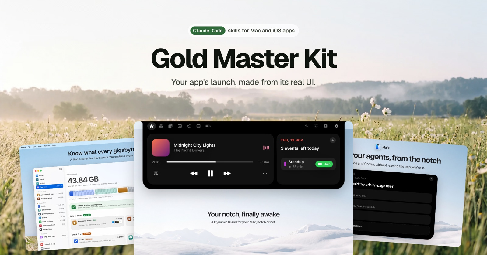

# Gold Master Kit

**Your Mac app's launch, made from its real UI.** 
Claude Code skills that read your app's repo and make its App Store screenshots, link previews and launch posts,
then check every file before you see it.

[Website](https://goldmasterkit.com) · [Buy, $29 for the first 25](https://goldmasterkit.com/#pricing) · [Free og-images skill](https://github.com/abdiraimov-otabek/claude-code-og-image-skill)

### What's inside

| Skill | Makes | |
|---|---|---|
| **store-screenshots** | App Store screenshots at Apple's sizes: Mac 2880×1800 and 1440×900, iPhone 1206×2622 | Ready |
| **og-images** | Link previews, a Product Hunt gallery and an X header | Ready, free |
| **launch-copy** | Product Hunt, X, Threads and r/macapps posts, every number checked against your README | Ready |
| **launch-video** | A 15 to 30 second promo in 9:16 and 16:9 | In progress |
| **landing-page** | A one-page site with Open Graph tags and FAQ schema | In progress |

### Tested blind

Three open-source Mac apps, three sets of App Store screenshots each, scored unlabelled by a judge out of 40:

| App | This kit | Claude Code on its own | The app's own App Store set |
|---|---|---|---|
| NetNewsWire | **31** | 23 | 22 |
| CotEditor | **29** | 26 | 27 |
| Maccy | **30** | 26 | 28 |

One judge, one run per app: a strong sign, not a study. [The method and the images](https://goldmasterkit.com/#proof).

Made by [Otabek Abdiraimov](https://github.com/abdiraimov-otabek), who builds [Halo](https://halo-mac.com) and [Shedi](https://shedi.app).
